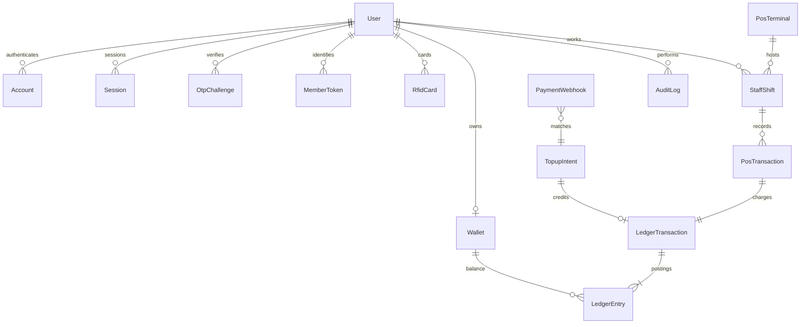
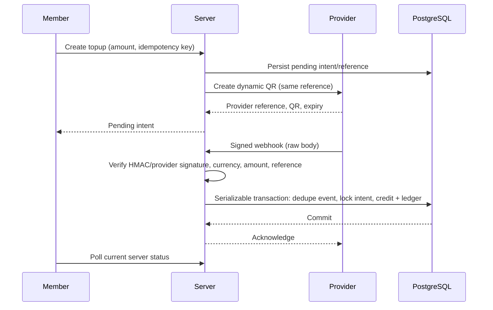

# SMART CANTEEN architecture (Phase 1)

## 1. Requirements and boundaries

Manual amount POS, Google-only registration, additional email OTP, unverified E.164 contact phone, server-owned wallets, dynamic QR top-up adapter, immutable double entry, employee RBAC and auditable administration. No product cart. Never approve offline or from cached balances. No real provider/device claims. Seed only in development. RFID is Phase 3 per the final phase schedule (the earlier RFID section says Phase 2); schema/API boundary prepared now.

## 2. System

Next.js 16 App Router modular monolith: Auth.js -> registration module -> wallet/ledger module -> POS module -> payment adapter. PostgreSQL is the source of truth. Prisma migrations plus SQL constraints/triggers enforce financial invariants. Redis provides shared rate limiting. External email/payment/OAuth adapters fail closed when unconfigured. Financial APIs never cache. Integer satang only; maximum transaction 1000000 satang, explicit THB currency. Member QR is a short lived single-use opaque bearer credential, never a member ID.

## 3. ERD

Authentication tables follow the Auth.js adapter. Profile/contact/role fields are held on User in this foundation; expanded permission grants, notifications, provider settings and card events are later migrations. Role policies are server-side, never client input. System accounts CLEARING, SALES and WALLET_LIABILITY use explicit debit/credit entries. A wallet is a member subledger, not an external bank account.

## 4. Authentication

Google verified email + provider subject -> pending user. Send random 6 digit OTP through Resend; store keyed HMAC only, expire after 5 minutes, max 5 attempts, 60-second resend cooldown plus shared rate limit. Verify once and collect E.164 phone, transactionally activate and create empty wallet. Subsequent Google logins do not repeat OTP. Secure HttpOnly SameSite sessions, expiry, origin checks for state changes. Public registration cannot set a role. Admin access fails closed until independently verified MFA is implemented; a boolean in a request is never sufficient. No password login or production development bypass.

## 5. Ledger

All mutations run in a serializable database transaction with bounded retry. Atomic conditional debit rejects insufficient funds by default. The owner explicitly approved a separate cashier confirmation to permit debt up to THB 50 per member; the server and database enforce the same -5000-satang floor and record newly borrowed money plus the approving actor. Topup: DR CLEARING, CR WALLET_LIABILITY. Purchase: DR WALLET_LIABILITY, CR SALES. Refund: DR SALES, CR WALLET_LIABILITY. Each posting amount is positive integer satang; debit and credit totals match. Database deferred trigger checks balancing and wallet reconciliation; update/delete of posted ledger is blocked. Idempotency key is unique and bound to actor, operation and payload; mismatch is rejected. Refund requires original purchase, reason and supervisor approval, cannot exceed unrefunded original amount. No deletion or edits to posted history.

## 6. Payment sequence

Sandbox uses explicitly simulated payment data, never a real PromptPay QR. Production refuses sandbox. Provider event ID and provider payment reference are both unique. Expired/mismatched events are rejected for investigation; external settlement reconciliation is required before production. Provider creation failure must remain retryable with the same intent reference. Do not call an external provider inside a retried database transaction.

## 7. POS

One screen: large numeric amount keypad -> confirm amount -> keyboard-wedge member token -> server identification -> automatic atomic charge when sufficient, or an explicit bounded-overdraft/cancel decision when insufficient -> receipt then reset. Identification does not consume the token; charge consumes it transactionally. Displayed balance is only a preview. Duplicate click reuses request key. No offline approvals, automatic retry with a NEW key or automatic claim of success after network failure. An active cashier and active unlocked terminal are required; no shift or exclusive terminal ownership is used. Admin terminal locks, logout and staff history use server operations. Camera QR scanning with local decoding is implemented; USB/manual token entry remains available. RFID endpoint remains unavailable until a challenge-response bridge is tested; UID alone never authorizes payment.

## 8. API plan

Auth: /api/auth/* (Auth.js). POST /api/registration/{send,verify,complete}. GET /api/wallet. POST /api/member-token. POST /api/topups; GET /api/topups/:id. POST /api/webhooks/sandbox (raw signed body). POST /api/pos/{identify,charge,cancel}; GET /api/pos/history. GET /api/admin/overview. All mutations validate Zod inputs, same-origin session requests, role/account status, rate limits. Webhook uses signature instead of browser session. Domain failures return stable error codes; internal detail is never exposed.

## 9. Design system

Warm white #fafaf7, gray #e5e7eb, emerald #047857, navy #14243b; Thai-capable system fonts with optional self-hosted IBM Plex Sans Thai. Mobile-first member balance, 48px+ touch targets for POS, labelled fields, visible keyboard focus, aria-live async status, no decorative animation, reduced-motion support. Shared shadcn-style Button/Card/Input components with Tailwind. Finance responses are never service-worker cached. PWA shell and camera are deferred until access/cache tests are complete.

## 10. Phases / acceptance gates

1. Foundation: runnable app + schema/migration + authenticated registration + wallet + sandbox topup + member token + manual POS + ledger + RBAC + audit. Must pass PostgreSQL concurrency/duplicate/balance tests. Live launch blocked on Google/Resend/payment sandbox tests, admin independent MFA, reconciliation, backups/restore and deployment review.
2. Provider production adapter, static biller only with supported references, reconciliation jobs, reports, notifications.
3. Authenticated card bridge, provisioning/revocation/replacement, hardware and Android tests.
4. Optional inventory, promotions, analytics, multiple branches.

## Dependencies

Use Next.js 16 stable, React 19, Prisma 7 PostgreSQL driver adapter. Auth.js currently documents v5 beta for Next.js; pin the resolved beta and explicitly treat this as a pre-release dependency requiring review, rather than claiming stable authentication packages. Official references: https://nextjs.org/docs/app/getting-started/installation ; https://authjs.dev/getting-started/installation ; https://www.prisma.io/docs/orm/v7/core-concepts/supported-databases/postgresql . Commit the package lock when the user creates the repository.
